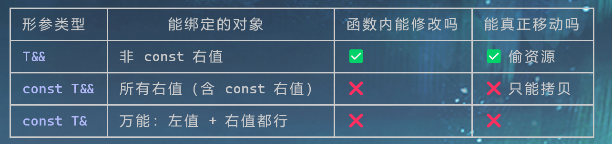

folly+abseil+qt


# 1.Cmake
```code
//强制要求cmake版本不低于3.25
cmake_minimum_required(VERSION 3.25)

//强制覆写c、c++编译器选择为路径中的位置，而不是由系统自行决定
set(CMAKE_C_COMPILER "/usr/bin/gcc" CACHE FILEPATH "C compiler" FORCE)
set(CMAKE_CXX_COMPILER "/usr/bin/g++" CACHE FILEPATH "C++ compiler" FORCE)

set(CMAKE_CXX_STANDARD 20)   //确定c++标准为20
set(CMAKE_CXX_STANDARD_REQUIRED ON) //强制要求为20，不允许切换
set(CMAKE_CXX_EXTENSIONS ON)  //启用编译扩展，导致代码无法迁移到其他编译器，同时允许一些编译器特有的语法

project(pans VERSION 0.1.0 LANGUAGE CXX C) //声明项目名，版本，使用语言
include(GNUInstallDirs) //引入标准安装目录变量，符合GNU惯例，避免硬编码，提升移植性
include(CMakePackageConfigHelpers) 生成包配置文件，支持外部项目find_package(pans)引用

//设置变量从而达到控制编译对象，也就是example，test，tool模块是否要编译
option(PANS_BUILD_EXAMPLES "Bulid examples" ON)
option(PANS_BUILD_TESTS "Bulid tests" ON)
option(PANS_BUILD_TOOLS "Bulid tools" ON)

//设置cmake的编译构建类型，有Debug Release RelWithDebInfo MinSizeRel四种类型
if(NOT CMAKE_CONFIGURATION_TYPES AND NOT CMAKE_BUILD_TYPE) //如果没有配置多生成器和单生成器，就设置单生成器为Debug模式
    set(CMAKE_BUILD_TYPE Debug CACHE STRING "Choose the type of build." FORCE)
endif()
set_property(CACHE CMAKE_BUILD_TYPE PROPERTY STRINGS Debug Release RelWithDebInfo MinSizeRel)
message(STATUS "Build Type: ${CMAKE_BUILD_TYPE}") //输出日志

cmake_host_system_information(RESULT CPU_NUMS QUERY NUMBER_OF_LOGICAL_CORES) //征询程序查询有多少个处理器
message(STATUS "CPU_NUMS on current server is: ${CPU_NUMS}")
math(EXPR JOBS "${CPU_NUMS} * ${CPU_NUMS} /2") //计算理想线程数
set(CMAKE_BUILD_PARALLEL_LEVEL ${JOBS} CACHE STRING "并行编译线程数")
message(STATUS "Complier default work jobs: ${CMAKE_BUILD_PAPALLEL_LEVEL}")

//可以适当通过任务超配来补足I/O导致的时间浪费，从而使得cpu资源得到充分使用

add_library(pans_options INTEFACE) //配置编译接口，不产生编译产物，只记录配置

//当编译器为gnu或clang，启用一下设置
target_compile_options(pans_options INTERFACE
    $<$<OR:$<CXX_COMPILER_ID:GNU>,$<CXX_CO<PLIER_ID:Clang>>:
        -Wall
        -Wextre
        -Wpedantic
        -fno-strict-aliasing
    >
)

//在linux系统上，
target_compile_options(pans_options,INTERFACE
    $<$<AND:$<PLATFORM_ID:Linux>,$<OR:$<CXX_COMPILER_ID:GNU>,$<CXX_CO<PLIER_ID:Clang>>>:
        -fPIC     
    >
)
编译参数
target_compile_options(pans_options INTERFACE
    $<$<CONFIG:Debug>: -o0>  优化
    $<$<CONFIG:Debug>: -g3>  调试信息
    $<$<CONFIG:Debug>: -ggdb> 适合gdb调试的拓展
)
```
# 2.assert封装
assert本质上就是宏定义包装的库，作为开发阶段的调试辅助宏
在于触发断言条件为假时，会向stdcerr输出表示性文本，__FILE__,__LINE__,__FUNC__,然后调用abort()终止进程

## NDEBUG宏
定义NDEBUG宏后，所有assert会被编译为空指令

debug模式下，需要额外时间来判断逻辑
release模式下，不然

```code
 if(!(x)) [[unlikely]] //告诉CPU 该条指令出现的可能不大，分支预测时，可以放心将其减少分配
    {
        std::cerr <<__FILE__ <<":"<<__LINE__<< "ASSERT FAILED: " <<#X <<"\nStacktrace: to do \n";
        assert(x)
    }

```
定义多行宏时，使用\来表示续行符
static_assert 编译期使用，几乎无开销

在连接对应库时，一般会将可连接对象直接展开，配置宏定义时,使用do——while(0)来避免对应的语法错误，如多一个分号
```code
#define ASSERT_RETVAL(x, val) \
    do{\
        if(x) [[likely]] break;\
        PANS_ASSERT(x);\
        return val;\
    }while(0)
```

[[nodiscard]] **C++17 引入的属性 (attribute)**，属于标准的**方括号属性语法 `[[...]]`**，给编译器提示信息，用于检测「函数返回值被故意忽略」的代码问题。

作用：
这个函数的返回值很重要，调用方不应该丢弃、不能不接收返回值；如果调用后直接忽略返回值，编译器给出警告

# 3.线程安全
lamda表达式中，全局变量不需要捕获的，其捕获的是局部变量
c++中的线程只要初始化就开始运行，不同于其他语言需要显式的启动

对于简单的循环变量，在开启03优化时，会进行循环优化，使得下列代码测不出数据竞争
```code
 []()->void{
 for(int i=0;i<count;++i)
 {
     ++money;
 }}
```
数据竞争的原因在于取数时不确定是什么时候的数，自增运算要分三步，取数，计算，存数

锁：在于保护数据，而不是语句

正确的思考顺序是：

1. 找出所有访问共享数据的代码 → 这些代码构成“临界区”
2. 锁必须完整覆盖临界区——漏掉任何一处访问，等于没锁
3. 不碰共享数据的重活，尽量留在锁外（这才是“粒度”的本意）

数据加锁：
1. 互斥锁mutex：
同一时间只有一个线程持有锁，最常用
不可拷贝，移动，不能对持锁线程再加锁，会造成死锁。

递归锁recursive_mutex：
同一线程可以重复加锁，只在于递归函数、嵌套中保护同一资源时使用

超时锁timed_mutex
允许线程等待超时，放弃持锁，防死锁，

读写锁 shared_mutex
读锁可多线程共享，但是写锁独占，适合读多写少
对于这个可以采用unique_lock(独占锁，写锁)，shared_lock(共享锁，读锁)

2. 信号量：
计数信号量counting_semaphore：
控制同时可用的资源数量

二元信号量binary_semaphore：
值为0或1，本质就是线程间事件通知

原子标志atomic_flag：
c++中唯一无锁原子类型

原子变量:
对于1/2/4/8字节的整型，编译器会生成CPU硬件原子指令，使得读改写在硬件层面不可分割，无需加锁

3.辅助加锁：
lock_guard RAII锁
构造时加锁，析构时解锁

unique_lock 灵活锁
在前者基础上，维护锁的状态，支持手动解锁

scoped_lock 多锁同时获取
一次锁定多个互斥量，避免死锁。

单线程：atomic最快，mutex有锁开销
多线程：atomic领先，mutex随线程数增加竞争加剧


## 线程间关系：
互斥：多个线程竞争同一独占资源，谁拿到谁占有
同步：多个线程按顺序配合执行完成一件事

互斥锁用来解决互斥
信号量用来解决同步，可以作为资源计数

## 自旋锁：
1. POSIX 自旋锁
pthread_spinlock特性：
抢锁失败会导致反复检查，不进入休眠，持续轮询锁状态
不主动放弃CPU，自旋期间占用核心，等待期间不切换线程
各平台实现并不相同

2. atomic_flag实现自旋锁

### 按照平台引入指定头文件
```code
#if defined(__x86_64__) || defined(__i386__)
#include<immintrin.h>
#elif defined(__aarch64__) || defined(__arm__)
#include<arm_acle.h>
#endif

#if defined(__linux__) && defined(__GLIBC__)
#include<pthread.h>
#endif

inline void cpu_relax() noexcept
{
    #if defined(__x86_64__) || defined(__i386__)
        _mm_pause(); //是CPU为自旋等待的特殊指令，x86上
    #elif defined(__aarch64__) || defined(__arm__)
        __yield();   //同上，但是是arm上
    #endif
}
```

inline+noexcept 零开销且无异常抛出

```code
原子变量只有0，1态

第一个线程进来时，mutex是false状态 ，然后为true，返回false，则外层循环终止

第二个线程来时，mutex是True状态，仍会设置为true，但是返回true，进入循环，判断内层循环。若为true则cpu等待，false则跳出
> 从而优化cpu运行
void lock() noexcept
    {//test_and_set函数会将mutex设置为True，然后返回原来的值
        while(m_mutex.test_and_set(std::memory_order_acquire))
        {
            while(m_mutex.test(std::memory_order_relaxed))
            {
                cpu_relax();
            }
        }
    }
两层结构，外层抢锁，内层探测
```

### CAS
即**比较并交换** compare-and-swap
只是一个硬件级原子指令，直接由cpu全权操作。
``code
 bool CAS(atomic<T>& addr, T& expected, T desired)
  {
      if (addr.load() == expected)   // 比较
      {
          addr.store(desired);       // 交换
          return true;               // 成功
      }
      expected = addr.load();        // 失败：把当前实际值写回 expected（很重要！）
      return false;
  }
```整体是一个完整过程，不会存在其他线程插在中间，修改对应值。
利用CAS循环，检查值
```code
  u64 expected = counter.load();          // 1. 拍照：记住旧值
  while (!counter.compare_exchange_weak(  // 3. 试探：只有值还是我拍的照时才写入
           expected, expected + 1))
  {
      // 失败说明有人抢先改了，expected 已被刷新为最新值
      // 什么都不用做，带着新值回循环重试即可
  }
```

#### 乐观悲观锁
乐观锁在于赌执行期间无其他人操作，悲观锁则是先锁住再说。

# 4. 日志

## 接口设计cmake
1. 接口设置
```code
#if defined(_WIN32) && defined(PANS_SHARED_LIBRARY) //是win32系统且是动态定义库PANS_SHARED_LIBRARY
#if define(PANS_BUILDING_LIBRARY)   //若编译时，定义了这个库
#define PANS_API __declspec(dllexport) //则通过declspec将连接符号都导入到dll中
#else
#define PANS_API __declspec(dllimport) //其他项目使用，则通过PANS_API来导入
#endif

#elif defined(__GNU__) && defined(PANS_SHARED_LIBRARY)
#define PANS_API __arrtibute__((visibility("default")))
#else
#define PANS_API
#endif
```

由此在函数或类名前使用PANS_API作为导出给动态库

#### 不可继承final
类名后+final表示不可继承

枚举变量类型 name：type 显式告诉编译器其中元素类型，不写默认为int
```code
enum class Level : std::uint8_t
```
X-Macro 交叉宏
把枚举值翻译成对应的字符串——传入 DEBUG，同时生成 LOG_LV_DEBUG
   这个枚举常量和 "DEBUG" 这个字符串。
```code
switch (level)
          {
  #define xx(name)               \
      case Level::LOG_LV_##name: \
          return #name;
              xx(DEBUG)
                  xx(INFO)
                      xx(WARN)
                          xx(ERROR)
                              xx(FATAL)
                                  xx(OFF)
  #undef xx
          }
```
本质上是将重复代码缩成宏展开
##是记号标记，用于将参数黏贴到对应位置
#是字符串化

命名空间 pans::detail
等价于namespace pans {namespace detail}

短日志放在栈上、长日志放在堆上，尽可能使用栈上
自定义缓冲区，从而减少string在拷贝时的开销

避免逻辑优化，可以使用一些额外的代价来取消
```code
u64 checksum = 0;
    const auto begin = std::chrono::steady_clock::now();
    for (u64 iteration = 0; iteration < g_target; ++iteration)
    {
        checksum += operation();
    }
    const auto end = std::chrono::steady_clock::now();
    BENCHMARK_SINK.fetch_xor(checksum, std::memory_order_relaxed);
    return std::chrono::duration_cast<std::chrono::nanoseconds>(end - begin);
```
BENCHMARK_SINK作为全局变量，编译器不保证其会不会被用到，故一直保留观察，同时fetch_xor是会保守处理操作。fetch_xor是原子性的“读写改”，即fetch_* 类型的函数都是如此，*是操作类型，xor就是做异或。memory_order_relaxed 只是放弃与其他内存操作的顺序保证（省去内存屏障开销，避免污染测量结果），它并不降低操作本身的可观察性——这一次写入仍然必须真实发生。

memory_order类参数，在于修改指令顺序，编译器CPU会重排指令、缓存内存数据。这些参数在于约束


>原子变量自增的约束在于线程安全和指令重排的严格安全，这种指令重排安全并不是指cpu完全不对指令进行重排优化，而是说它与其他变量之间的相对顺序不会出现问题。
>通过fetch_add(1,memory_order_relaxed)实现自增时，在于只将其作为一个计数器使用，但是不保证其作为标志来推断其他数据操作的安全。相较于原先的自增，降低了指令重排后的安全；
> 原子性操作返回都是旧值


```code
static_cast<u64>(value.size()) +
           static_cast<unsigned char>(value.front()) +
           static_cast<unsigned char>(value[value.size() / 2]) +
           static_cast<unsigned char>(value.back());
```
这样可以使得每次操作一定是从缓冲区实实在在的获得数据，由此再确保测试的正确性


explicit 禁止编译器产生隐式转换

在linux系统中
localtime_r是线程安全的，但是消耗也大：
* 1. 全局有锁可能排队
* 2. 需要进行复杂的时区计算(尤其是有过夏令时变更历史的时区)
* 3. 如果系统没有加载时区信息或者要求响应时区变更, 每次调用这个接口还要去发起磁盘IO，读系统文件/etc/localtime

```code
using FormatItemFactory = std::unique_ptr<Formatter::FormatItem> (*)(std::string_view)
```
这是一种函数指针的申明方式，别名使其更具有可读性，本质是返回类型是std::unique_ptr<Formatter::FormatItem>，参数为string_view


```code
 m_item.push_back(std::make_unique<LiteralFormatItem>(std::move(literal)));
```
 std::move 本身不移动任何东西

  它只是一次强制类型转换，把左值 literal 转成右值引用：

  std::move(literal)  // 近似等价于 static_cast<std::string&&>(literal)

  真正干活的是被它「标记」出来的移动构造函数。效果对比：

  std::string literal = "2026-09-12 [logger] 一大段字面文本...";

  // 不加 move → 拷贝构造：新对象申请内存，逐字节复制内容（O(n)）
  std::make_unique<LiteralFormatItem>(literal);

  // 加 move → 移动构造：新对象直接"接管"literal 内部的缓冲区指针（O(1)）
  std::make_unique<LiteralFormatItem>(std::move(literal));

literal 是循环里累积字面字符的局部变量，转移到 FormatItem
  之后不再被使用（通常紧接着就 literal.clear()
  或等下一轮重新填充），所以「掏空它」没有任何副作用——这正是 std::move
  的标准使用时机：对象即将死亡前，把它的内脏捐赠出去。

  两条注意事项

  1. move 之后的 literal
  处于「有效但未指定」状态——可以析构、可以赋新值，但不要读它的内容；
  2. 若 LiteralFormatItem 的构造函数参数写成 const std::string&，move
  会静默失效退化为拷贝——想吃到移动优化，参数必须是按值传递 std::string 或
  std::string&&。


  override 只是在继承类中使用，表示要子类函数覆盖基类的已有的虚函数

```code
template <typename T>
    void AppendInteger(FormattedRecordBuffer &output, T value)
    {
        std::array<char, 24> buffer{};
        const auto result = std::to_chars(buffer.data(), buffer.data() + buffer.size(), value); // 基本上不会失败，转失败了也没关系
        ASSERT_RETNONE2(result.ec == std::errc(), "trans " << value << " to chars failed.");
        output.append(buffer.data(), static_cast<std::size_t>(result.ptr - buffer.data()));
    }
```
to_chars是效率极高的转换函数，返回std::to_chars_result结构体，含ptr 实际内容末尾的下一个位置，ec 错误码

当接口要对外暴露时，可以通过类内再设置一个Impl类，来收留类中的实际实现，从而达到隐藏类内实现的效果；
以及删除移动构造、拷贝构造、移动赋值、拷贝赋值
```code
Appender(const Appender &) = delete;
Appender &operator=(const Appender &) = delete;
Appender(Appender &&) = delete;
Appender &operator=(Appender &&) = delete;
```


noexcept
不是“请求编译器帮我保证不抛”，而是“我用人格担保不抛，否则程序直接处决”。所以它只该用在您真正确定的地方，比如只包含内建类型操作的函数、移动构造等

windos utf-16 ->wchar_t linux utf-32
设计都将其转换为utf-8，反之亦然 

匿名命名空间（unnamed namespace）的核心效果只有一个——内部链接（internal——linkage），但由此衍生出许多实用的特性
核心在于链接期隔离，对应内容只在当前的cpp文件中，编译器生成独有的私有副本，链接期看不见从而不会与其他cpp中的同名符号冲突，不会被其他文件的extern引用。同时会得到很激进的优化策略，dll是不会导出其中的符号的

//todo string_utils.cc中unicode转换

//thread返回值：PID
windows返回内核的线程ID，系统线程ID，其他系统下是线程ID的哈希值

thread_local 每个线程都持有该声明对象的副本，从而避免每次系统都取调用获取

#### alignas 内存对齐分配。定位new(placement new)
##### 定位new
c++17 前使用以下方式
typen =new(adrr) 来在对应的地址位置开辟对象
要注意的是，malloc返回void*，new返回对应类型point

alignas 强制要求后续声明的数组要内存对齐到合适位置上

```code
alignas(std::max_align_t) std::byte m_implStorage[LOG_LINE_IMPL_SIZE]
```
开辟一个长度为LOG_LINE_IMPL_SIZE,起始地址为16字节对齐的原始字节流->只是开辟了一个原始内存空间，是在栈上开辟的。
如果不添加alignas的话，字节流开辟直接从1字节处对齐，如果最后日志中有成员变量的指针就会指在未对齐的位置上，从而出现未定义行为UB。

>如地址在147的位置存放字节流，12byte大小，最后8位是一个double，按字节流reinterpret时，double起始于151的位置，不是8位的倍数，读取时解释错误。

>结构和类，一般按照内部最大字节数对齐。


alignof函数则是获取该对象类型的对齐字节数，reinterpret_cast<type>是强制类型转换
construct_at(space，Args),该函数在于向指定空间构造类型指针,后面的Args是构造函数的参，返回的指针，编译器会认为是唯一正确的转换后的对象，但是从其他路径获得时，编译器还会认为是字节流，所以需要下面的函数，来告诉编译器这是新的类型解释
launder(space)
destroy_at 删除对象

类型转换：
1. static_cast 一定检查的常规转换
2. dynamic_cast 多态类型的安全下行转换(带运行时检查)
3. const_cast 只增删const/volatile
4. reinterpret_cast 按位重新解释，字节一个不动，只换类型tag

#### C语言可变参数处理：
```code
void LogPrintf(Logger &logger, LogLevel::Level level, u32 line, std::string_view file_name, const char *format, ...)
    {
        LogLine log_line(logger, level, line, file_name);
        if (format == nullptr)
        {
            log_line.stream() << "<null-format>";
            return;
        }
        std::array<char, PRINTF_FORMAT_INLINE_CAPACITY> inline_buffer;
        va_list arguments;
        va_list arguments_copy;
        va_start(arguments, format);
        va_copy(arguments_copy, arguments);
        const int required_size = std::vsnprintf(inline_buffer.data(), inline_buffer.size(), format, arguments);
        va_end(arguments);
        if (required_size < 0)
        {
            va_end(arguments_copy);
            log_line.stream() << "<format-error>";
            return;
        }
        const std::size_t message_size = static_cast<std::size_t>(required_size);
        if (message_size < inline_buffer.size())
        {
            va_end(arguments_copy);
            log_line.stream().write(inline_buffer.data(), static_cast<std::streamsize>(message_size));
            return;
        }
        std::vector<char> overflow_buffer(message_size + 1);
        const int second_result = std::vsnprintf(overflow_buffer.data(), overflow_buffer.size(), format, arguments_copy);
        va_end(arguments_copy);
        if (second_result < 0)
        {
            log_line.stream() << "<format-error";
            return;
        }
        log_line.stream().write(overflow_buffer.data(), static_cast<std::streamsize>(overflow_buffer.size()));
    }
```
va_list 参数遍历游标，在经过vsnprintf时，内部会通过va_arg取参数，不可修复，所以函数中要拷贝一份
va_start(va_list,format)初始化游标，第二个参数必须是传参时...前的参数，用来定义可变参数从哪开始

> 底层实现依赖于寄存器的四个指针，起始、偏移；
va_copy 就是再复制拷贝一份
va_end 清理收尾，所有声明的va_list都要清除

vsnprintf(char* buf,size_t size,const char* format ,va_list ap);
1. 返回负数：格式串非法
2. 返回N 这个字符应该写N个字符，不包含"\0",与size无关
N<size 全部都装下了，buf中是完整结果；反之，被截断了，但是N会告诉应该是多少


### 单例模式
经典形式：
```code
class Singleton
 {
 public:
     Singleton(const Singleton &) = delete;
     Singleton(Singleton &&) = delete;
     Singleton &operator=(const Singleton &) = delete;
     Singleton &operator=(Singleton &&) = delete;
    static Singleton &Instance()
     {
         static Singleton instance; // 保证线程安全，guard_visible,对象的实际构造会延迟到实际使用的时候：懒汉式
         return instance;
     }
    void log(const std::string &msg)
     {
         std::cout << "[LOG]: " << msg << std::endl;
     }
private:
     Singleton() = default;
     ~Singleton() = default;
 };
```
最简单的实现
变式1：模板单例类
```code
template <typename T>
    class Singleton
    {
    public:
        static inline T &Instance()
        {
            static T instance;
            return instance;
        }
        Singleton(const Singleton &) = delete;
        Singleton(Singleton &&) = delete;
        Singleton &operator=(const Singleton &) = delete;
        Singleton &operator=(Singleton &&) = delete;
    private:
        Singleton() = delete;
    };

class A
{
public:
    void log(const std::string &msg)
    {
        std::cout << "[LOG]: " << msg << std::endl;
    }
    A(const A &) = delete;
    A(A &&) = delete;
    A &operator=(const A &) = delete;
    A &operator=(A &&) = delete;

private:
    A() = default;
    ~A() = default;

    friend class pans::Singleton<A>;
};
```
在声明其他类后，作为模板参数传入Singleton<T>，一定要声明友元，这样才可以在调用时，Singleton可以访问到私有的A()构造函数，从而构造对象.Singleton是访问单例的manager，而A才是实际的单例，A的构造析构函数一定要私有

变式2：
crtp 继承单例模板,奇异递归模板
```code
template <typename T>
    class Singleton
    {
    public:
        static T &Instance()
        {
            static T instance;
            return instance;
        }
        Singleton(const Singleton &) = delete;
        Singleton(Singleton &&) = delete;
        Singleton &operator=(const Singleton &) = delete;
        Singleton &operator=(Singleton &&) = delete;

    protected:
        Singleton() = default;
        ~Singleton() = default;
    };

    class A : public pans::Singleton<A>
{
    friend class pans::Singleton<A>;

public:
    void log(const std::string &msg)
    {
        std::cout << "[LOG]: " << msg << std::endl;
        std::cout << "data: " << m_data << std::endl;
    }

private:
    A()
    {
        std::puts("A: A() -- only once");
        m_data++;
    }
    ~A()
    {
        std::puts("A::~A() --only once");
    }

private:
    int m_data{0};
};
```
> 指针版本：
1. 简易版本：非线程安全，实际上对于new对象，底层在于三个步骤，先分配空间，然后调用构造函数，返回对象指针。线程增加时，返回对象指针时，可能出现，给与未构造对象的情况
```code
static Singleton *Instance()
    {
        if (m_instance == nullptr)
        {
            m_instance = new Singleton();
        }
        return m_instance;
    }
inline static Singleton *m_instance = nullptr;
```
2. 加锁mutex
保证安全，但是加锁解锁带来的io开销大
```code
static Singleton *Instance()
    {
        std::lock_guard<std::mutex>lock(m_mutex);
        if (m_instance == nullptr)
        {
            m_instance = new Singleton();
        }
        return m_instance;
    }
inline static Singleton *m_instance = nullptr;
inline static std::mutex m_mutex;
```
3. 双重检查锁
对于编译器，指令优化时进行重排，无法确保安全，可能拿到未初始对象
```code
static Singleton *Instance()
    {
        if (m_instance == nullptr)
        {
            std::lock_guard<std::mutex> lock(m_mutex);
            if (m_instance == nullptr)
            {
                m_instance = new Singleton();
            }
        }
        return m_instance;
    }
```
4. 原子变量
将接口声明为原子变量，通过memory_order_**指令，保证对应操作重排时，不在构造的指令前，但是缺少对应的释放器
```code
static Singleton *Instance()
    {
        Singleton *temp = m_instance.load(std::memory_order_acquire);
        if (temp == nullptr)
        {
            std::lock_guard<std::mutex> lock(m_mutex);
            temp = m_instance.load(std::memory_order_relaxed);
            if (temp == nullptr)
            {
                temp = new Singleton();
                m_instance.store(temp, std::memory_order_release);
            }
        }
        return temp;
    }
inline static std::atomic<Singleton *> m_instance{};
inline static std::mutex m_mutex;
```

5. 最终版本+crtp
增加辅助类，帮助管理对应指针，同时利用RAII机制，回收资源
```code
static T *Instance()
    {
        T *temp = m_instance.load(std::memory_order_acquire);
        if (temp == nullptr)
        {
            std::lock_guard<std::mutex> lock(m_mutex);
            temp = m_instance.load(std::memory_order_relaxed);
            if (temp == nullptr)
            {
                temp = new T();
                // 只有成功创建实例后才注册退出清理器，并且必须在发布指针前完成。
                RegisterCleanup();
                m_instance.store(temp, std::memory_order_release);
            }
        }
        return temp;
    }

    static void Destroy() noexcept
    {
        // 先撤回已发布的指针，再销毁对象，避免留下悬空的原子指针。
        T *instance = m_instance.exchange(nullptr, std::memory_order_acq_rel);
        delete instance;
    }

    class Cleanup
    {
    public:
        Cleanup() = default;
        Cleanup(const Cleanup &) = delete;
        Cleanup &operator=(const Cleanup &) = delete;

        ~Cleanup()
        {
            Singleton<T>::Destroy();
        }
    };

    static void RegisterCleanup()
    {
        // 函数局部静态对象只初始化一次，并在正常退出程序时自动析构。
        static Cleanup cleanup;
        (void)cleanup;
    }

    inline static std::atomic<T *> m_instance{};
    inline static std::mutex m_mutex;
```

#### static线程安全
 编译器会给每个需要动态初始化的局部 static
  变量配一个隐藏的守卫变量，并把代码改写成大致这样：

```code
static Singleton &Instance() {
    static Singleton instance;
    // 编译器 conceptually 展开为：
    // ────────────────────────────────────────
    static Singleton instance;         // 仅分配内存（零初始化，加载期完成）
    static uint64_t guard = 0;         // 隐藏守卫：0=未初始化
    if (!__guard_ready(guard)) {                  // ① 快路径：一次原子 acquire 读
        if (__cxa_guard_acquire(&guard)) {        // ② 慢路径：CAS/加锁，仅一个线程成功
            try {
                construct(&instance);             // ③ 真正执行构造函数
                __cxa_atexit(dtor, &instance);    // ④ 注册析构（保证析构顺序）
                __cxa_guard_release(&guard);      // ⑤ 置完成标志 + release，唤醒等待线程
            } catch (...) {
                __cxa_guard_abort(&guard);        // ⑥ 构造抛异常 → 重置守卫，下次重试
                throw;
            }
        }
        // ② 返回 false 的线程在此阻塞/自旋，直到 ⑤ 完成
    }
    return instance;
}
```


# 5. cmake引入第三方库
第三方库，大编译库，对于wsl需要调整运行时空间大小，以及swap空间切换，从而使得系统不出现OOM

智能指针，可以通过指定模板的第二个参数，来自定义删除器，这是一个可调用对象；get函数，不增加引用计数，而返回对应指针

### 获取堆栈信息
堆栈信息中，对于c++返回格式
编译路径+行号(偏移地址)[虚拟地址]


**在linux系统中**：
dwfl：libdwfl库中的核心句柄，这是一个不透明结构体，只能通过指针使用。其在于代表调试信息会话的顶层上下文。处理符号化，模块管理，栈回溯。

dwfl_begin(&Calbacks) 创建句柄 
Dwfl_Callback
```code
 typedef struct
  {
    Dwfl_Callbacks_FindElf *find_elf;      // ① 根据模块名找主 ELF 文件
    Dwfl_Find_Debuginfo    *find_debuginfo; // ② 找分离的调试信息
    Dwfl_Callbacks_Section *section_address;// ③ 内核模块场景：节的加载地址
    char **debuginfo_path;                  // ②的搜索路径
  } Dwfl_Callbacks;
```
获取运行时进程的配置：
>dwfl_linux_proc_find_elf, dwfl_standard_find_debuginfo, nullptr, nullptr

1. dwfl_linux_proc_report
作为报告体，统合所有的堆栈信息，然后返回
2. dwfl_linux_end()
该句柄的创建只能手动删除，使用该函数
3. Dwfl_line,不透明结构体，记录report中的一条信息。
4. dwfl_getsrc() 获取信息中的一条对象
5. dwfl_lineinfo 返回对应的消息格式，如文件名，线程名。
__cxa_demangle函数，返回反编译的c++文件格式，从而获得file_name;

**Windows**
该系统下，使用HANDLE 句柄来操作核心，本质也是一个不透明结构体

使用DbgHeldper系统的调试文件助手，在线程上存在漏洞，需要手动加锁

SymSetOption，设置HANDLE句柄的返回格式，
1. SYMOPT_DEFERRED_LOADS 延缓符号连接，直到使用时加载
2. SYMOPT_LOAD_LINES 加载对应的行列号
3. SYMOPT_UNDNAME 返回时，取消对应c++文件的混淆操作

对于有默认值的函数，.h声明后，.cpp其实现不需要再写默认值

c++17 clamp函数

# 6.配置模块
>yaml，xml


### 6.1 编译器确定变量类型
或用type_traits，类型萃取

确定类型，使用探针法或者类型萃取，两者各有优劣
>探针法：通过source_location库来获取编译期的函数签名，从而得到对应类型。天然覆盖所有的变量类型，只要模板可以实例化，就可以获取。代码轻量可控，但是输出固定，只能使用编译器签名。

>类型萃取：属于标准做法，不会因为编译器的不同而导致结果差异，输出安全可控，但是代码量很巨大，相当于是通过特化维护了一张表，实例化是查表返回类型

编译器在编译时，对各个函数数据存有签名，直接通过各自宏获取签名

c++20引入文件路径source_location
#if defined(_MSC_VER)
mscv编译器下，直接使用编译器宏__FUNCSIG__

其余使用库函数 source_location::current().function_name();

各编译器返回类型签名
// GCC: consteval std::string_view pans::detail::TypeNameProbe() [with T = int;...]
// Clang: std::string_view pans::detail::TypeNameProbe() [T = int]
// MSCV: pans::detail::TypeNameProbe<int>(void) noexcept

>通过std::source_location::current().function_name()或__FUNCSIG__获得带有实例化<T>的完整函数签名，然后通过声明为consteval在编译期执行切割，获得具体的T，从而在编译期求值，运行时使用

constexpr 根据实际情况，编译器求值或运行期
consteval 必须编译期确定，在申明这样的变量前后，使用cout这些非常量求值表达式，也即是非constexpr，会报错


## 6.2 string->yaml.node转换

#### [[noreturn]] 
这个表示函数不会把控制流返回给调用者
适合于一下情况：
- 总是抛异常，throw
- 总是终止程序 exit，abort，terminate
- 无限循环

在声明之后，编译器在控制语句上做优化：
1. 对于一些死代码可以删除.不声明时，编译器不保证每个分支的出现可能，都需要注意，无法做一些优化。fatal函数声明noreturn后，编译器知道触发就会终止，路径分析会精确，同时也会消除调用之后的死存储
```code
int divide(int a, int b) {
    if (b == 0)
        fatal("div by zero");
    return a / b;
}
```
2. 同时知道函数会闭合，不要求有返回值的函数写return.c++23封装了std::unreachable()作为这个用途
```code
int parse(int t) {
    switch (t) {
    case 1: return 10;
    case 2: return 20;
    }
    fatal("bad token");   // 若 fatal 没有 [[noreturn]]，这里会警告
} 
```
3. 需要注意出现UB,标记了 [[noreturn]] 但函数实际能返回，就是UB，编译器可警告（-Winvalid-noreturn），生成的代码可能完全不符合预期。
```code
[[noreturn]] void maybe_throw(bool c) {
      if (c) throw std::runtime_error("x");
      // 若 c 为 false，函数实际返回了 → 未定义行为（UB）
  } 
```


string_view && string 对象周期不一致
1. string:
> 拥有RAII机制，会分配内存，超过SSO时会申请堆分配，为指针+大小+容量构成，保证\0结尾(c_str()h函数)，拷贝是深拷贝
2. string_view
> 只是原string的视图，不分配内存，为指针+长度（16字节，纯值类型）,data()不保证以\0结尾,不能修改，浅拷贝

> 后者的生命周期完全依赖于原string的生命周期。需要注意出现悬空指针的情况


```code
message.append("ConfigConvert<").append(type_name).append(">: ").append(reason);
```
这种写法是方法链或流式接口，整个过程中并没有额外的构造开销，没有中间产物，性能很好
相较于+操作，+虽然在c++11以后靠移动和重载缓解临时的string，但是仍可能存在多次缓冲区交接

c++20模板参数约束
requires 和consept

remove_cv是移除模板参数T的顶层const和volatile

typename C::value_type &&value
这种申明在于告诉编译器这里的C是类型还是值，保险起见，当作为类型使用时，还是添加上这个显式声明。

is_arithmetic_v判断不了bool，这也是整数运算类型，根本原因在于bool可以隐式转换为int参与运算

```code
template <typename T>
concept YamlDecodable = requires(const YAML::Node &node, T &out) {
    { YAML::convert<T>::decode(node, out) } -> std::convertible_to<bool>;
};

template <typename T>
concept YamlEncodable = requires(const T &value) {
    { YAML::convert<T>::encode(value) } -> std::convertible_to<YAML::Node>;
};
```
concept约束时，是在编译器确定是否特化这个模板，
requires(Args) {表达式}->return_type
表达式必须是语法正确的，在编译器中根据该语句true or false 最后根据return_type 返回结果

#### 命名返回值优化 RVO NVRO
返回值优化优先，如果不行再退化为移动

基于c++11 移动语义 c++17 强制拷贝省略

RVO 返回临时匿名对象 return value optimization
>c++17后，一律使用构造函数，直接原地构造，向外返回自身，期间存在一个隐藏指针，该指针直接指向外部接受返回值的对象，从而减少开销

对于RVO而言，构造对象是一个临时对象，是将亡值，也就是右值，编译器直接优化，将构造指向外部接受变量

NRVO (named return value optimization)
返回有名字的局部变量，但并不是强制的优化，满足一下条件就可以进行
>1. 返回的就是居名局部变量本事
>2. 类型严格一致，即变脸type和函数返回值
>3. 所有return路径返回同一个对象
>4. 不是函数形参

而NRVO，编译器需要确定，当前的具名对象在函数栈帧中会不会使用，判断开销很大，所以NRVO优化，并不是强制要求

>不要手动在return时使用move，这会使得NRVO失败，最坏情况下，将零成本变为一次移动构造

#### STL容器类模板参数
T：element  A: Allocator(分配器)  C:compare(排序函数)
H:Hash(Hash算法)  E:equality(哈希冲突后相等判别)

#### extern误区
extern 声明该变量在他处(.cpp)定义，由链接器自行寻找定义位置，获取对象。在.h中使用后，只声明，不分配。

## 配置导入模块
####  mutable
在被const约束的领域内，可以进行该改变。其在于将逻辑常量性和物理常量性分离。对于const，其在逻辑上约束，但mutex则是保证只在实现细节处做出修改。
mutable不可修饰static/const成员
- mutable 成员变量：
>通过const声明的成员函数，this指针实际上是const this，从而约束函数中的变量，不能发生改变。但是mutable的变量，可以获得豁免。
>mutex申明为mutable，对于读锁，mutex确实要在内部修改，如果不声明mutable，编译报错。

- lambda表达式
>其本质上是一个匿名闭包，在按值捕获变量时，捕获变量只是一个闭包中的局部变量，而且是常指值，无法修改，如果要修改，就要加mutable声明

# 协程

## 进程空间
进程PCB中，存放代码段(编译后的可执行机器指令，也就是函数本体)、数据段(存放已经初始化的全局变量和静态变量，运行期一直存在)、BSS段(存放未初始化的全局变量和局部变量)、堆(由低地址向上分配，运行时动态申请的内存，new malloc)、栈(函数调用的上下文，如局部变量、函数参数、保存的寄存器等，全自动管理，函数调用时压栈，返回时弹栈，从高地址向下分配)

## 线程资源：
- 线程栈：函数调用栈、局部变量，每个线程独立，默认8MB(linux),1MB(Windows)，可设置大小
- 寄存器现场/程序计数器： 各个线程执行到哪，互不影响，线程切换时，这个执行上下文保存到TCB(thread contronl block)中
- 线程id，信号掩码(n个信号就是n位掩码，pedding 待处理信号,blocked 被屏蔽信号，线程由用户态切换到内核态时，检查信号掩码，pedding & ~blocked-> 根据结果执行对应处理)
- errno，线程局部存储：如thread_local变量。errno全局错误码
- 调度属性：优先级、CPU亲和力。亲和力：设置亲和掩码后，调度器不会把线程调度到掩码之外的 CPU。

>线程共享资源： 完整的虚拟地址空间：代码段、数据段、BSS、堆、
>已经打开的文件描述符、当前的工作目录、信号处理方式

线程切换： 用户内核态切换、硬件上下文全量保存、运行调度算法、刷新CPU缓存与TLB、恢复状态返回

## 协程
一个具有独立运行栈的可调度可被挂起的运行单位

- 有栈协程 boost库(支持有栈和无栈)
每个协程自带一个可改变大小的协议栈，同时增加一个guardPage，防止栈用尽，污染到其他协程。切换采用汇编级切换，减小os开销，同时可以在任意深度中进行挂起，

>但存在一个问题： 有栈协程中，创建时绑定唯一线程，在深度过深时，catch可能无法捕捉到对应异常，从而需要通过const boost::context::detail::forced_unwind & 将err throw出来
> 当协程检查时，发现深层次的调用栈已经回收，则通过forced_unwind将上层所有对象全部析构，由此将异常隐藏了。

- 无栈协程： C++20 coroutine
主要是通过编译器实现一个状态机函数调用.编译器自行生成一个协程栈，用来存取协程相关的变量，每当协程函数状态切换时，就自行通过状态级切换协程编号。

> 无法在普通函数内部挂起协程，如果内部需要使用，这需要在一整条链路上都申明这是需要co_await的

### enable_shared_from_this
底层实现：在于将类对象自身make_shared，然后返回weak_ptr,从而不影响count计数。从而使得该类不增加引用计数，同时不延长生命周期。
只有在通过lock时计数+1，并将所有权交给下一个调用者

由此，在网络编程中，通过HttpConnect异步连接时，通过lambda表达式不断捕获当前的网络上下文，从而使得对应的链接不会中断。asio的声明周期等价于当前Server端的运行，只有在当前的服务器停止运行后，其生命周期才会结束

### test_fiber Impl
对于协程，本质上在于将获取线程的执行权，然后自行执行代码块。线程在执行时，会依照两个寄存器指针：RIP(指令指针)，RSP(栈指针)
主线程调用自行实现的fiber库
在进行协程切换时，也就是执行boost::context::fiber::resume()函数时，会自行将RIP指向fiber::caller中的代码块，RSP指向协程栈，而主线程进入运行态

>parked表示当前协程调用者，协程栈是否已经归位于context，保证当前协程栈只在自己手里，在物理上进行约束
>state：当前的协程状态，全程可改，故需要suspendstate来约束协程的进入，其只存取上一次协程调用者是以协程什么状态离开的。

>context和caller不会同时有效，fiber运行时caller中保存着回到主线程的路径，fiber停止时，context存放着fiber运行的位置

>心智模型：栈，而且实际上也是这样的，主线程自己的栈，通过resume，将指令流切换到协程栈上运行，然后协程栈的yield直接切回主线程自己的栈，如此反复，直到协程正式完成工作

对于test1的整个流程可以这样理解：
1. 初始化fiber：
通过make_shared构造fiber指针，构造函数中指明CallBack代码块，然后在fiber无参构造函数中调用有参重载构造，获取options参数(默认stacksize=1024KB和guardPage=True)
2. 初始化m_impl内部执行类
先通过g_nextFiberId分配协程id号，从1开始，然后检查栈空间分配是否合适，初始化上下文,将外部的callback存储到内部类中，使用entry作为协程开始执行的入口动作，entry定义了三个步骤，先将caller存入到m_impl的caller，然后调用run,再将caller返回出去，然后初始化结束，协程总数g_fiberCount++，m_impl->context赋为先前的初始化好的上下文
3. 第一次执行resume()
对协程状态做检查，发现是init状态，就切换为ready，然后将parked置为false，对外表示不能更改。上下文由context持有，内部存放的是协程执行到哪里，caller存放的是唤醒协程的主线程的微型指针，也就是resume函数内部。context为2中初始化的new_context,entry会在当前协程第一次resume时运行，然后将caller存为当前的主线程的resume()结束后的现场，触发boost::context::fiber的resume函数，顺利执行的话，就会调用run()函数执行callback。然后直到协程执行完或者协程内部挂起，才对外返回新的context，作为结果
4. 协程执行
执行到YieldToReady()时，调用yield函数，然后将caller置为空，move了，协程停止运行，回到主线程，开始继续执行resume的剩余部分，执行完后，将context置为刚才协程停止的位置。此后如此

##### 显式丢弃
```c++
auto invalid = std::make_shared<pans::Fiber>([]() {}, invalid_options);
static_cast<void>(invalid);
```
通过这样转换，显式丢弃掉无用值


